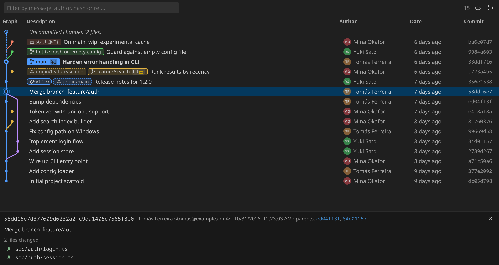

# Git Wave

A fast git graph with worktrees.

[](https://marketplace.visualstudio.com/items?itemName=rgro.git-wave)
[](LICENSE)



## Why

Git Graph is unmaintained, GitLens is heavy, and neither treats worktrees as first-class.
Git Wave is a small, dependency-free extension that draws the graph on a canvas, renders only the
rows on screen, and puts worktrees (including what is locked, and why) right in the picture.

## Install

Search for **Git Wave** in the Extensions view, or:

```sh
code --install-extension rgro.git-wave
```

- **Graph view** in the familiar lanes-and-curves style: branches, tags, remotes, and HEAD on a
  canvas-drawn graph with a virtualized commit list. Only the rows on screen are ever rendered,
  so 100k-commit repositories scroll smoothly.
- **Worktrees, everywhere.** A *Worktrees* panel in the Source Control sidebar lists every
  worktree, which branch it has checked out, and whether it is **locked** (with the reason).
  The same worktrees show up on the graph as badges on their commits.
- **Lock / unlock / add / remove / prune** worktrees from the sidebar or straight from a badge in
  the graph. Prunable (stale) worktrees are flagged.
- **Uncommitted changes** row at the top with a dashed strand down to HEAD; select it to see the
  working-tree files and open their diffs. Right-click it to stash or discard the changes.
- **Right-click actions** on commits, branches, remote branches, tags, stashes and worktree badges:
  checkout, create branch, create tag, merge (fast-forward, merge commit, squash, ff-only), rebase,
  cherry-pick, revert, reset (soft/mixed/hard), rename, delete, apply/pop/drop stash, copy.
  Native VS Code menus, so they follow your theme and keybindings.
- **Remotes from the graph.** Push, pull and set upstream on branches, open a pull request
  (GitHub, GitLab, Bitbucket), and delete remote branches and tags. Branch tags show how far
  ahead (↑) or behind (↓) their upstream they are as of the last fetch.
- **Worktree-aware checkout.** Checking out a branch that lives in another worktree offers to open
  that worktree instead of failing.
- **Author avatars** from GitHub (using your `gh` CLI login when available, so no rate-limit
  trouble) or Gravatar, with initials as a fallback.
- **Stashes** appear as dashed nodes hanging off their base commit.
- **Commit details** with changed files; click a file to open its diff. No dependency on the
  built-in Git extension.
- Instant filter by message, author, hash, or ref name. Resizable Author and Date columns.
- Wide histories scroll horizontally inside the graph column (shift+wheel or the slim scrollbar).
- Auto-refreshes when refs, HEAD, the working tree, or worktree metadata change.

## Usage

- Command Palette: **Git Wave: Open Graph**, or the branch icon in the Source Control title bar.
- The **Worktrees** view lives in the Source Control sidebar. Hover a worktree for its path,
  HEAD, and lock reason. Inline buttons lock/unlock and open the worktree in a new window.
- In the graph, click the folder badge on a branch chip (or a dotted worktree chip for a detached
  worktree) for the worktree actions menu. A padlock on the badge means the worktree is locked.
- Click a parent hash in the details pane to jump to it. `↑`/`↓` move the selection, `Esc` closes it.

## Settings

| Setting | Default | Description |
| --- | --- | --- |
| `gitwave.commitsPerPage` | `500` | Commits fetched per page; more load as you scroll. |
| `gitwave.showRemoteBranches` | `true` | Include remote-tracking branches. |
| `gitwave.showTags` | `true` | Include tags. |
| `gitwave.dateFormat` | `relative` | `relative`, `absolute`, or `iso`. |
| `gitwave.graph.laneWidth` | `14` | Pixels per lane. |
| `gitwave.graph.rowHeight` | `24` | Row height in pixels. |
| `gitwave.graph.colors` | 10 colours | Lane colours, cycled. |
| `gitwave.graph.visibleLanes` | `12` | Lanes shown before the graph column scrolls horizontally. |
| `gitwave.avatars` | `true` | Show author avatars. |

## Development

```sh
npm install
npm run build        # bundles dist/extension.js and dist/webview.js with esbuild
npm test             # unit tests for the lane layout and git parsers (node:test)
npm run watch        # rebuild on change
```

Press `F5` in VS Code to launch an Extension Development Host with Git Wave loaded.
`npm run package` produces a `.vsix` you can install with `code --install-extension`.

### Releasing

```sh
npm run release -- minor     # or patch / major / 1.2.3
```

That bumps the version, stamps the changelog, commits, tags `vX.Y.Z` and pushes. The Release
workflow then runs the tests, publishes to the Marketplace, and attaches the `.vsix` to a GitHub
release. It needs a `VSCE_PAT` repository secret (an Azure DevOps token with the
*Marketplace (Manage)* scope).

### How the graph is laid out

`src/graph/layout.ts` is a streaming lane allocator. Commits are fed in git's output order (children
before parents) and each one yields a row: its lane, its colour, and the strands drawn between it
and the row above. State is only the set of currently open lanes, so pages of commits can be appended
without touching earlier rows. The webview draws the visible slice on a canvas and recycles a small
pool of DOM rows for the text columns.

## License

MIT. Git Wave is written from scratch and shares no code with other graph extensions.
